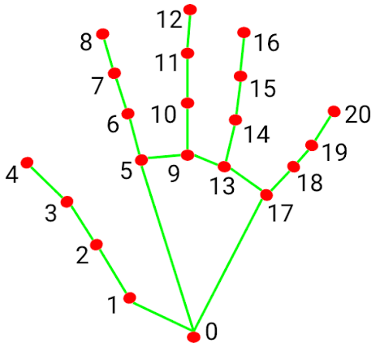

# Gestures mode:
- Index up -> **move left**
- Index + middle finger up -> **move right**
- Index, Middle and ring finger up -> **move up**
- Index, Middle, Ring and pinky up finger -> **move down**
- index, ring, pinky up, middle down -> **move forward**
- Index, middle, pinky up, ring down -> **move backwards**
- index down, middle, ring and pinky up -> **land**
- thumbs up -> **standby**
- If hand is not detected -> wait 30 seconds before landing

**Follow Mode:**
- Only pinky pointing up -> 'attach' to the hand and keep it in frame by automatically following
*Failsafe during follow mode:*
If hand is no longer detected stop movement descend slowly and deactivate

**Mediapipe hand landmarks diagram:**


## Telemetry
- Receive telemetry data from the drone to the host laptop
- Accelerometer, distance sensor, gyroscrope readings, battery status, signal strength
- Create a second window (apart from the camera view) that has an interface showing telemetry data, a picture of the drone that rotates as the actual drone does (use the gryo and/or accelerometer to get the data to transform the image)
- Window also has a button that allows the user to enable/disable gesture control and take over manual control of the drone using the keyboard (arrow keys for movement, comma and period for down and up respectively, f for do a flip if it's possible)
- Window also shows signal strenght, battery level, etc.

Run the telemetry window separately while the drone is connected to the Tello
Wi-Fi network:

```bash
python telemetry.py
```

The window reads the Tello's cached state data and displays battery, height,
time-of-flight distance, pitch, roll, yaw, acceleration, and Wi-Fi signal.
The drone indicator rotates using the reported yaw. Use the mode button to
switch between gesture and manual mode. In manual mode, focus the telemetry
window and use the arrow keys for horizontal movement, `,` and `.` for down
and up, and `F` for a forward flip when supported by the drone.

The telemetry window sends commands through its own worker queue so a slow
Tello response does not block the Qt interface. In this combined mode it also
starts the Tello video stream and launches the MediaPipe camera-control loop;
the annotated camera feed appears in the `Hand Tracking` window. Close the
telemetry window or press `Q` in the camera window to stop and land.

Use either `telemetry.py` for the combined telemetry, video, and gesture
session, or `droneControl.py` for the camera-control-only session. Do not run
both scripts at the same time; both would try to control the same Tello.

## Workspace setup

Each contributor should create their own Python virtual environment locally. Do not
commit the `.venv` directory or other machine-specific files.

### Create and activate the environment

From the repository root:

```bash
python3 -m venv .venv
source .venv/bin/activate
```

On Windows PowerShell, activate it with:

```powershell
.\.venv\Scripts\Activate.ps1
```

If PowerShell says that running scripts is disabled, allow scripts only in the
current PowerShell session, then activate the environment:

```powershell
Set-ExecutionPolicy -Scope Process -ExecutionPolicy Bypass
.\.venv\Scripts\Activate.ps1
```

This does not change the machine-wide execution policy; the setting goes away
when you close that PowerShell window. Alternatively, skip activation and use
the environment's Python executable directly:

```powershell
.\.venv\Scripts\python.exe -m pip install --upgrade pip
.\.venv\Scripts\python.exe -m pip install -r requirements.txt
```

Then install the shared project dependencies:

```bash
python -m pip install --upgrade pip
python -m pip install -r requirements.txt
```

The dependency file should contain only packages required by this project. Do not
add machine-specific editable paths or the output of a full `pip freeze` unless
the team has agreed to maintain a platform-specific lock file.

Verify the selected environment with:

```bash
python -c "import cv2; import djitellopy; print('environment OK')"
```

In VS Code, use **Python: Select Interpreter** and choose the interpreter inside
`.venv`.

## Run gesture control with the Tello camera

This connects to the Tello, starts its video stream, and runs gesture control
on the drone camera feed. The drone takes off and begins gesture control at
its normal takeoff height. Each stable movement gesture moves the drone 10 cm. The `land` gesture and
pressing **Q** land the drone. Press **F** in the video window to take off
again after landing. Follow mode uses the hand's horizontal position, vertical
position, and apparent size to attempt to keep the hand centered and at a
consistent distance.

1. Power on the Tello and connect your computer to the drone's Wi-Fi network.
2. Run this from the repository root:

   ```powershell
   .\.venv\Scripts\python.exe droneControl.py
   ```

Press **Q** in the video window to land and stop. If the connection fails,
confirm that your computer is connected to the Tello's Wi-Fi and try again.

Do not run this with people, obstacles, or fragile objects nearby. Keep a clear
landing area and be ready to disconnect the battery if the drone behaves
unexpectedly.

Before committing, check that local files are ignored:

```bash
git status
git check-ignore -v .venv/ .env __pycache__/
```

Commit `requirements.txt`, but keep `.venv/`, `.env`, `__pycache__/`, and other
local or generated files untracked.
